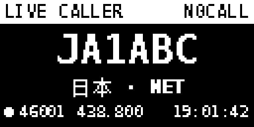
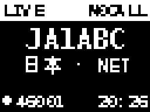

# mmdvm-ysf-addon

[English](README.md) | **简体中文**

**在你已经在用的 Linux 机器上顺手加一个轻量 MMDVM 热点——默认 YSF，可选 DMR 和 D-Star。不换系统、不刷独立镜像、可以卸载回滚。**



---

## 这是什么

很多 MMDVM 热点方案要求刷专用镜像（Pi-Star / WPSD），把整台机器变成热点机。
这个项目走另一条路：**它是现有机器上的 add-on**，适合家里已经在跑 Ubuntu/Debian
的服务器、桌面 Pi 或电台电脑。

它会增加：

- 独立的 `mmdvm` 系统用户
- systemd 服务：`ysfgateway`、`mmdvmhost`、`oled-display`，可选
  `dmrgateway`、`dstargateway`
- `/etc/mmdvm`、`/var/log/mmdvm`、`/var/lib/mmdvm`
- `/usr/local/bin/{MMDVM-Host,YSFGateway,oled_display.py}`；启用时还会安装
  `DMRGateway` / `dstargateway`
- 日常命令 `./mmdvm onboard`、`./mmdvm update`、`./mmdvm status`
- `/var/backups/mmdvm` 下的 root-only 更新快照，用于回滚
- Raspberry Pi 上的 boot overlay（Pi 5 用 `uart0-pi5`；Pi 4/3 用
  `enable_uart` + BT overlay，实验性）
- 构建/运行依赖（见下文）

它**不会**替换 OS、改启动顺序、刷 HAT 固件、重装桌面或接管无关服务。x86 这类没有
Pi GPIO 的平台**完全不会改 boot 配置**。

> 老实说：它**不是零改动**。会安装包、增加用户/目录/三到五个服务，在 Pi 上还会改
> boot 配置。所以项目提供 preflight 冲突检查和 uninstall 回滚。

## 轻量化设计

- 没有 Web UI、数据库、Docker 栈，也不捆绑 MQTT broker。
- YSF 只需要一个小网关；DMR/D-Star 网关只在启用时下载源码并编译，禁用时不会留下
  额外二进制。
- OLED 由一个很小的 Python 服务直接绘制，不引入显示框架。
- 一个静态 YSF 反射器条目、一个可选 DMR master、一个可选 D-Star 反射器。

## 平台支持

| 平台 | 状态 | 调制解调器连接 | OLED |
|---|---|---|---|
| **Raspberry Pi 5 + Ubuntu 26.04** | **作者实机验证** | GPIO14/15 HAT，`dtoverlay=uart0-pi5` | Pi I2C-1 0x3C；SSD1306 128x64 实测 |
| Raspberry Pi 4 / 3 / Zero 2 W | **实验性，未实机验证** | GPIO14/15 HAT，`enable_uart=1` + `miniuart-bt`/`disable-bt`，需重启 | Pi I2C，理论可用 |
| x86_64 Ubuntu / Debian | **仅构建/CI，硬件未测** | **USB 串口 MMDVM 板**（ttyUSB/ttyACM）；Pi GPIO HAT 不能直接插 | 通常没有；外接 I2C 未验证 |
| 其它 Linux / 特殊 UART 桥 | 手动/不支持 | USB 串口；自行设置 `MODEM_PORT` | 可选/手动 |

CI 只能证明上游源码、补丁和本项目能在 x86_64 GitHub runner 上构建；**不能**证明
UART、USB 枚举、I2C、systemd 安装、射频或反射器 link。只有下面的 Pi 5 YSF 组合在
真实硬件上验证过。DMR 和 D-Star 已实现，但作者**没有实机测试**。

## 已验证环境

- Raspberry Pi 5 Model B，**Ubuntu 26.04.1 LTS (arm64)**
- MMDVM_HS_Hat 固件 `MMDVM_HS_Hat-v1.5.2 20201108 14.7456MHz ADF7021 FW by CA6JAU`
- 板载 SSD1306 OLED，Pi I2C-1 `0x3C`
- YSF 反射器 `46001 / CN-C4FM-TG46001`（`222.128.4.82:42000`）
- 作者：BI2RIP（FT-5D / FTM-510D）

作者在同一块 HAT 上实测过 **144.3000 MHz 2m** 配置；公开示例故意使用
**438.8000 MHz**。144.300 是 2m 弱信号/SSB 呼叫区域，**不建议**作为热点默认频点，
详见频率说明。

## 前提

- 一台现有 Linux 机器；Ubuntu/Debian + systemd 是支持的安装路径。
- Pi：兼容的 MMDVM HAT，STM32 固件已刷好，GPIO14/15 空闲。
- x86：**USB 串口 MMDVM 调制解调器**（或 USB-TTL 接到调制解调器）。
- 有效业余呼号，以及当地协调好的频率。
- 可选 OLED 需要 Python 3 + Pillow（`python3-pil`）。
- DMR：需要 DMR ID 和 BrandMeister 热点安全密码。
- D-Star：需要支持 D-Star/已注册的呼号和反射器（注册规则取决于反射器网络）。
- 首次安装时机器上不能已有 MMDVM / Pi-Star / WPSD；preflight 会拒绝覆盖。
  `./mmdvm update` 有独立的快照式接管模式，只支持本 add-on 的 legacy 安装，
  仍拒绝 Pi-Star/WPSD。
- 本项目**不**刷固件、不提供预编译镜像。

## 快速开始

```bash
git clone https://github.com/fuyifu2024/mmdvm-ysf-addon.git
cd mmdvm-ysf-addon
./setup.sh
```

推荐直接用 `setup.sh`。它会：

- 没有 `config.env` 时交互询问呼号、频率、`MODEM_PORT` 和 OLED 面板
- 询问是否启用 DMR（DMR ID、master、隐藏输入密码）和 D-Star（反射器 + 模块）；
  两者默认都**关闭**
- 拒绝 `N0CALL`（必须填真实呼号）
- 先跑 preflight，再用 sudo 准备 UART/依赖/用户组
- 渲染配置并构建上游（内存低时自动 `JOBS=1`；DMR/D-Star 网关只在启用时编译）
- 安装/启动服务并打印状态

常用参数：

```bash
./setup.sh --dry-run          # 只显示计划，不改系统
./setup.sh --yes              # 跳过最后确认
./setup.sh --non-interactive  # 使用预先编辑好的 config.env
./setup.sh --rebuild          # 强制重新编译
```

Pi 4/3 首次可能提示重启；重启后重新运行 `./setup.sh`，配置和系统准备会保留。
x86 若找不到串口，接上 USB MMDVM 调制解调器后重跑。`prepare-system.sh` 不会重启
无关服务；`install-services.sh` 只重启本项目的服务。

## 日常命令

首次安装完成后，用仓库根目录的 `./mmdvm`，不用反复跑安装器：

```bash
./mmdvm onboard        # 改呼号/频率/反射器/OLED/DMR/D-Star
./mmdvm update         # 拉代码、构建、无损重装
./mmdvm status         # 等同 scripts/status.sh
./mmdvm version        # 仓库版本 + 已安装版本
./mmdvm help
```

### 快速改配置（onboard）

`onboard` 读取现有 `config.env`，每个字段都显示当前值；直接回车保留原值。DMR 密码
不会显示，密码提示留空即保留。

```bash
./mmdvm onboard --dry-run    # 只校验并显示变更，不写文件
./mmdvm onboard              # 交互修改并应用
./mmdvm onboard --no-apply   # 只保存 config.env，不重启服务
```

候选配置使用和 setup 相同的渲染器校验。应用时会先快照，再渲染、按需编译新启用的
可选网关、安装服务并检查 active；任何一步失败都会恢复上一份配置、二进制、unit 和
服务状态。

如果 `config.env` 不存在但 `/etc/mmdvm` 已存在（包括同样是 `ysfgateway`/`mmdvmhost`
unit 的手动安装），onboard 会先询问是否导入呼号、频率、串口、反射器、OLED、DMR 和
D-Star 设置。读取 root 所有的 `/etc/mmdvm` 可能需要 sudo；DMR 密码只写入本地，
不会打印。

### 无损更新（update）

```bash
./mmdvm update --dry-run     # 显示版本/状态和新配置键；不用 sudo
./mmdvm update               # 拉取、快照、构建、安装、验证
./mmdvm update --no-pull     # 用当前源码树（ZIP/手动覆盖）
./mmdvm update --adopt       # 非交互接管旧的 /etc/mmdvm 安装
```

修改系统前，`update` 会在 `/var/backups/mmdvm/<UTC 时间戳>/` 建立 root-only 快照：

- `/etc/mmdvm`（包括 DMR 凭据）
- 本项目的二进制、systemd unit、drop-in 和 logrotate 文件
- 仓库的 `config.env`
- 每个服务的 enabled/active 状态

保留最近 5 份。日志、`/var/lib/mmdvm` 的 D-Star 数据、Pi boot 配置都不动。校验、构建、
安装或安装后的服务检查失败时，会自动恢复快照并重启旧服务。成功后快照保留，可手动
回滚：

```bash
sudo python3 scripts/state_backup.py restore /var/backups/mmdvm/<时间戳>
```

`update` 只把 `config.example.env` 里新增的键按默认值补进去，不覆盖已有值。仓库是
干净的 git checkout 时会先跑 `git pull --ff-only`；工作树有改动、网络失败或不能
快进时，会在修改系统前中止。Download ZIP 用户请手动替换源码并用 `--no-pull`。

作者的现场电台**不会**被这些工具自动修改；接管/升级始终由用户显式执行，并先生成
快照。

### 手动/进阶安装

```bash
cp config.example.env config.env
$EDITOR config.env          # CALLSIGN、FREQUENCY、MODEM_PORT、反射器...

./scripts/preflight.sh      # 只读：平台、串口、OLED、冲突
sudo ./scripts/prepare-system.sh
python3 scripts/render_configs.py
./scripts/build.sh
sudo ./scripts/install-services.sh
./scripts/status.sh
```

也可以用 Makefile：

```bash
make preflight
make config
sudo make prep
make build
sudo make install
make status

# 首次安装之后
make onboard
make update
make version
```

如果 `prepare-system.sh` 提示 UART 尚未就绪，重启一次再继续。

## 配置

把 `config.example.env` 复制为 `config.env`（已被 git 忽略）再编辑。

### 电台与串口

| 键 | 含义 |
|---|---|
| `CALLSIGN` | 呼号，3–10 位大写字母/数字。`N0CALL` 只是占位符，发射前必须改。 |
| `SUFFIX` | YSF 节点后缀，通常是 `ND`。 |
| `FREQUENCY` | 单工热点频率（MHz），收发同频。公开示例：`438.8000`。 |
| `MODEM_PORT` | `auto`（只有一个串口时自动找，优先 by-id）或明确的 `/dev/...` 路径。 |
| `MODEM_BAUD` | 串口速率；MMDVM_HS 实测为 115200。 |
| `REFLECTOR_ID` | YSF 反射器/房间号，例如 `46001`。 |
| `REFLECTOR_COUNTRY` | 反射器国家前缀，例如 `CN`。 |
| `REFLECTOR_NAME` | 反射器短名，例如 `C4FM-TG46001`（不含国家前缀）。 |
| `REFLECTOR_STARTUP` | 完整名，必须等于 `COUNTRY-NAME`，例如 `CN-C4FM-TG46001`。 |
| `REFLECTOR_HOST` | 反射器 IPv4 地址或主机名。 |
| `REFLECTOR_PORT` | 反射器 UDP 端口，46001 用 `42000`。 |
| `REFLECTOR_DESC` / `HOTSPOT_NAME` / `HOTSPOT_DESC` | 显示/描述标签。 |

### OLED

| 键 | 含义 |
|---|---|
| `ENABLE_OLED` | `auto`（安装时探测）、`0`/`no`（关闭）、`1`/`yes`（强制）。 |
| `I2C_BUS` | I2C 总线号，默认 `1`。 |
| `I2C_ADDRESS` | OLED 地址，默认 `0x3C`。 |
| `OLED_CONTROLLER` | `auto`/`ssd1306`（默认）、`ssd1309`、`ssd1315` 或 `sh1106`。 |
| `OLED_SIZE` | `128x64`（默认）、`128x32` 或 `64x48`；这里 SH1106 只支持 128x64。 |
| `OLED_ROTATE` | `0` 或 `180`（屏幕装反时用）。 |
| `OLED_CONTRAST` | `0x00`–`0xFF`，默认 `0xCF`。 |

### 可选模式

| 键 | 含义 |
|---|---|
| `ENABLE_DMR` | `1` 时通过本地 DMRGateway 启用 DMR；默认 `0`。 |
| `DMR_ID` | 数字 DMR ID（启用 DMR 时必填）。 |
| `DMR_MASTER` | BrandMeister master 主机名，默认 `4601.master.brandmeister.network`。 |
| `DMR_PORT` | master UDP 端口，通常 `62031`。 |
| `DMR_PASSWORD` | BrandMeister 热点安全密码。只存本地，不会打印。 |
| `DMR_COLOR_CODE` | DMR 色码，默认 `1`。 |
| `ENABLE_DSTAR` | `1` 时通过本地 DStarGateway 启用 D-Star；默认 `0`。 |
| `DSTAR_REFLECTOR` | 反射器和模块，例如 `REF001 C`、`XRF012 C`、`DCS001 C`、`XLX123 C`。 |
| `DSTAR_MODULE` | 热点模块字母 `A`–`D`，默认 `C`。 |

### 为什么 `Startup` 必须是完整名

当前 YSFGateway 源码用 `findByName()` 匹配 `Startup`，不是按数字 ID。hosts JSON
里的名字由 `COUNTRY + "-" + NAME` 组成，因此：

```ini
REFLECTOR_COUNTRY=CN
REFLECTOR_NAME=C4FM-TG46001
REFLECTOR_STARTUP=CN-C4FM-TG46001
```

三者必须一致。`render_configs.py` 会校验，避免网关静默地“找不到反射器”。

### 串口

`MODEM_PORT=auto` 优先找单个 `/dev/serial/by-id/...`，然后依次尝试
`/dev/ttyAMA0`、`/dev/serial0`、`/dev/ttyUSB*`、`/dev/ttyACM*`、`/dev/ttySC*`。
有多个串口时 auto **不会乱猜**，请写稳定的 by-id 路径：

```ini
MODEM_PORT=/dev/serial/by-id/usb-...-if00
```

生成的 `MMDVM-Host.ini` 会写入解析后的 `UARTPort`。改动后重新渲染并重启。

### 频率

- 示例使用 **438.8000 MHz**（常见 UHF 热点频点）。确认本地没有中继/热点占用，
  并遵守本国波段规划。
- 作者的 **144.3000 MHz** 2m 实验只作为现场记录。144.300 是 2m 弱信号/SSB
  呼叫区域，不适合当公开默认值。
- 第一次发射建议接假负载或确认可用的天线。不要拿 430 MHz 天线在 144 MHz 发射。

## 可选 DMR 网络（BrandMeister）

DMR 默认**关闭**。MMDVM-Host 不能直接向 BrandMeister 认证，所以本项目用 G4KLX 的
**DMRGateway** 做本地桥接：

```text
MMDVM-Host  ── 127.0.0.1:62031/62032 ──  DMRGateway  ── UDP 62031 ──  BrandMeister
```

- 在 `config.env` 里设置 `ENABLE_DMR=1`、`DMR_ID`、`DMR_MASTER`、`DMR_PASSWORD`
  （或按 setup 提示输入）。
- 密码只写入 `config.env`（交互式 setup 后权限 600）和
  `/etc/mmdvm/DMRGateway.ini`（root:mmdvm，0640）；脚本不会打印，也不会进 git。
- 只有启用 DMR 时才安装 `DMRGateway` 及其配置；下次安装时禁用 DMR 会移除二进制和
  服务。
- 生成的网关在两个时隙上放行所有 talk group 和私密呼叫；在电台上照常选择 TG。
  需要更严格的路由策略时自行编辑 `DMRGateway.ini`。
- BrandMeister 账号/热点密码和有效 DMR ID 由你负责；遵守网络规则和当地法规。
- **作者未实机验证**。源码已锁定且 CI 会编译，但这里没有做过空中 DMR 测试。

## 可选 D-Star 网络

D-Star 默认**关闭**。MMDVM-Host 需要本地 D-Star 网关，本项目用
**F4FXL/DStarGateway**（ircDDBGateway 的去 wxWidgets 移植版）：

```text
MMDVM-Host  ── 127.0.0.1:20010/20011 ──  DStarGateway  ── DPlus/DExtra/DCS/XLX
```

- 设置 `ENABLE_DSTAR=1`、`DSTAR_REFLECTOR`（例如 `REF001 C`）和 `DSTAR_MODULE`。
- 构建会检查 `libcurl4-openssl-dev` 和 `libboost-dev`；`prepare-system.sh` 只在启用
  D-Star 时安装它们。
- 初始反射器 hosts 列表和语音提示会复制到 `/var/lib/mmdvm/dstargateway.d/`；
  网关之后可能自行更新。重新安装不会覆盖已有文件。
- 生成配置禁用 ircDDB 和 APRS，启用 DPlus/DExtra/DCS/XLX。
- 反射器网络可能要求已注册的 D-Star 呼号；注册和访问规则不在本项目范围内。
- **作者未实机验证**。CI 会编译网关，但这里没有做过空中 D-Star 测试。

## OLED Live Caller

OLED 是可选的。作者实测的是 Pi I2C-1 `0x3C` 上的 SSD1306，由主机绘制，不是 STM32
固件驱动。服务读取 `/etc/mmdvm/oled.env`，该文件由 `config.env` 渲染而来。

### 屏幕兼容性

| 控制器 | 128x64 | 128x32 | 64x48 | 说明 |
|---|---|---|---|---|
| SSD1306 / SSD1309 / SSD1315 | **实测** | 可选 | 可选 | `OLED_CONTROLLER=auto` 映射到 SSD1306 |
| SH1106 | 可选 | — | — | 132 列 RAM，可见 128 列在偏移 2 |

只有 SSD1306 128x64 在真实硬件上验证过。其它尺寸/控制器使用同一驱动，并有 CI
预览覆盖，但在你确认自己的模块前都应视为未实测。屏幕装反时设
`OLED_ROTATE=180`；太亮/太暗可调 `OLED_CONTRAST`。

| 128x32 (0.91") | 64x48（小屏） |
|---|---|
|  |  |

### 128x64 布局

```text
▓ LIVE CALLER        <你的呼号> ▓
        <发射者呼号>
      <国家/地区> · NET/RF
● <反射器> <频率>          <时钟>
```

- 主行：当前/最近发射者的呼号。
- 右上角：自己的呼号（`OWN_CALL`）。
- 地区：用呼号前缀离线推断；YSF 帧里没有姓名/城市。
- `NET` 表示网络来音，`RF` 表示本地射频来音；RF 还会显示 BER。
- 静默 90 秒后显示 `STANDBY`。

128x32 和 64x48 使用紧凑三行布局：状态/自己呼号栏、发射者呼号、地区。
64x48 还会显示 link 点、反射器和时钟。

### 预览与测试

不碰 I2C 也能生成 PNG 预览（在没有 OLED 的机器上安全）：

```bash
python3 oled/oled_display.py --preview /tmp/oled-128x64.png \
  --own-call N0CALL --reflector 46001 --frequency 438.800 \
  --demo-call JA1ABC --size 128x64

python3 oled/oled_display.py --preview /tmp/oled-128x32.png --size 128x32 --demo-call JA1ABC
python3 oled/oled_display.py --preview /tmp/oled-64x48.png  --size 64x48  --demo-call JA1ABC
python3 oled/oled_display.py --preview /tmp/oled-sh1106.png \
  --controller sh1106 --size 128x64 --rotate 180 --demo-call JA1ABC
```

`ENABLE_OLED=auto` 时若没找到 OLED，安装器会跳过 OLED 服务，MMDVM 仍正常运行。
中文地区名需要 DejaVu + Droid fallback 字体；极简系统没有这些字体时会退回点阵字体，
无法显示中文。

## 工作原理

```text
FT-5D / FTM-510D  （YSF 用 C4FM DN；DMR/D-Star 依电台支持）
        │  144/430 MHz
        ▼
MMDVM 调制解调器（STM32 HAT 或 USB MMDVM）
        │  UART: /dev/ttyAMA0 或 /dev/ttyUSB...
        ▼
   MMDVM-Host ── 127.0.0.1:3200/4200 ── YSFGateway ── UDP 42000 ── YSF 反射器
        │
        ├─ 可选 DMR：  127.0.0.1:62031/62032 ── DMRGateway ── BrandMeister
        └─ 可选 D-Star：127.0.0.1:20010/20011 ── DStarGateway ── 反射器

OLED（可选，I2C）◄── oled_display.py ◄── /var/log/mmdvm 日志
```

| 服务 | 作用 |
|---|---|
| `ysfgateway` | 连接 YSF 反射器，把 MMDVM-Host 桥接到 YSF |
| `mmdvmhost` | 驱动调制解调器和启用的射频模式 |
| `dmrgateway` | 可选的本地 DMR 到 BrandMeister 桥 |
| `dstargateway` | 可选的本地 D-Star 网关 |
| `oled-display` | 读日志并驱动可选的 I2C 屏幕 |

日志：`/var/log/mmdvm/ysfgateway.log`、`/var/log/mmdvm/mmdvmhost.log`、
`/var/log/mmdvm/dmrgateway.log`；D-Star 日志在 `/var/log/mmdvm/` 和 journald。
服务错误仍进 journald。

## 平台说明

### Raspberry Pi 5

`prepare-system.sh` 会往 `/boot/firmware/config.txt` 加 `dtoverlay=uart0-pi5`，
尝试运行时加载，并在存在时禁用 `ttyAMA0` 的 serial getty。只有 `/dev/ttyAMA0`
仍不存在时才需要重启。这是**实测**路径。

### Raspberry Pi 4 / 3 / Zero 2 W（实验性）

**未实机验证**。`prepare-system.sh` 会加 `enable_uart=1`，优先用
`dtoverlay=miniuart-bt`（蓝牙移到 mini-UART），否则退回 `dtoverlay=disable-bt`
（关闭蓝牙）。它会修改 `/boot/firmware/config.txt` 或 `/boot/config.txt`，先备份，
并且需要重启。请确认你的板子上 `/dev/ttyAMA0` 确实连到调制解调器；在桌面系统上
关闭蓝牙可能有副作用。

### x86_64 + USB MMDVM 调制解调器（仅构建/CI，硬件未测）

- Pi GPIO HAT 不能直接插 x86；请用 USB 串口 MMDVM 板。
- x86 **不会**碰 `/proc/device-tree/model`、`config.txt`、`dtoverlay`、`pinctrl`
  或 serial-getty。
- 在 `MODEM_PORT` 里写稳定的 `/dev/serial/by-id/...`（只有一个调制解调器时 auto
  也可以）。
- 主机会原生构建同样的 MMDVM-Host/YSFGateway/DMRGateway/DStarGateway；CI 只能
  证明 x86_64 编译，不证明安装或射频。
- 通常没有 OLED；用 `ENABLE_OLED=0`。外接 USB-I2C 屏幕未验证。
- 非 apt 发行版需自行安装构建依赖。

### 其它 Linux / 特殊 UART 桥

手动处理。SC16IS752/SPI-UART HAT 需要自己的内核 overlay/驱动和明确的
`MODEM_PORT`；本项目不会自动配置这类桥。非 systemd 系统不在支持范围内。

## 会改什么

| 会增加 | 不会改 |
|---|---|
| 软件包：构建工具、mosquitto/JSON 开发库、python3-pil、i2c-tools；D-Star 额外需要 libcurl/boost | OS 或启动镜像 |
| 用户 `mmdvm`；串口/I2C 用户组 | 启动顺序或固件 |
| `/etc/mmdvm`、`/var/log/mmdvm`、`/var/lib/mmdvm` | 无关服务 |
| `/usr/local/bin` 下的二进制（可选网关只在启用时） | 桌面/网络配置 |
| 三到五个 systemd 服务 | 已有 MMDVM/Pi-Star/WPSD（首次安装拒绝；update 模式支持本 add-on/legacy 接管） |
| `/var/backups/mmdvm` 下 root-only 快照（最多 5 份） | 日志、D-Star 数据、boot 配置 |
| 仅 Pi：`config.txt` overlay/备份；禁用 serial getty | x86 的 boot 配置（完全不动） |

`uninstall.sh` 会删除 add-on 文件、停止服务，并从备份恢复 Pi boot 配置。
它**不会**卸载共享软件包。

## 上游源码与补丁

`build.sh` 下载内容锁定（SHA-256）的上游 tarball：

- `g4klx/MMDVMHost`
- `g4klx/YSFClients`（YSFGateway）
- `g4klx/DMRGateway`（仅启用 DMR 时）
- `F4FXL/DStarGateway`（仅启用 D-Star 时）

对 YSFGateway 应用两个补丁：

1. **`0001-ysfgateway-optional-mqtt.patch`** — 上游 YSFGateway 在本地没有 MQTT
   broker 时会退出；补丁让它继续运行。
2. **`0002-ysfgateway-ifstream-hosts.patch`** — 上游用 `std::fstream`（读写）打开
   hosts 文件，root 只读的 `/etc/mmdvm/YSFHosts.json` 会触发 `EACCES`；补丁改用
   `std::ifstream`。

`upstream.lock` 记录 URL 和 SHA-256。上游变化时构建会失败；确认补丁兼容后再更新
lock。

## 验证

```bash
./scripts/status.sh
tail -n 20 /var/log/mmdvm/ysfgateway.log
```

YSF 正常时能看到：

```text
Loaded 1 YSF reflectors
Linked to CN-C4FM-TG46001
```

可选模式：

```bash
systemctl status dmrgateway.service
systemctl status dstargateway.service
tail -f /var/log/mmdvm/dmrgateway.log
journalctl -u dstargateway.service -f
```

作者实测 YSF 配置的电台设置：

- 频率：配置的单工频率（示例 438.8000 MHz）
- 模式 **DN**
- 不加 CTCSS/亚音
- DG-ID 0
- 不要按 WIRES-X（这是直连热点，不是 WIRES-X 按钮流程）

DMR 用 DMR 电台，选择热点期望的 TG/配置，并确保 DMR ID 与 BrandMeister 账号一致。
D-Star 用 DR 模式并选择配置的反射器/模块；注册要求因网络而异。

## 故障排查

| 现象 | 检查 |
|---|---|
| 找不到串口 | `./scripts/preflight.sh`；只有一个设备时用 `MODEM_PORT=auto`，否则写 by-id 路径。 |
| Pi 5 没有 `/dev/ttyAMA0` | `grep uart0-pi5 /boot/firmware/config.txt`；重启一次；确认 GPIO14/15 没被别的服务占用。 |
| Pi 4/3 UART 不工作 | 确认 `enable_uart=1` 和所选 BT overlay；重启；确认 `/dev/ttyAMA0` 映射。实验性。 |
| MMDVM-Host 反复重启 | `journalctl -u mmdvmhost`；检查串口、HAT 供电/固件、波特率（实测 115200）。 |
| 网关起来但 YSF 不 link | 确认 `Startup` 是完整名；检查反射器地址/端口；看网关日志。 |
| `Unable to load/parse JSON file` | 确认 ifstream 补丁已编译并安装。 |
| 日志里 MQTT connection refused | 无害；不需要 MQTT broker。 |
| DMR 不登录 | 检查 `DMR_ID`、`DMR_MASTER`、`DMR_PASSWORD`，以及 62031/62032 是否被占用；看 `dmrgateway.log`。 |
| D-Star 不 link | 检查反射器名/模块、注册、20010/20011，以及 `journalctl -u dstargateway`。 |
| OLED 不亮 | `ENABLE_OLED=auto`/`1`；`i2cdetect -y <bus>`；检查总线/地址、控制器、尺寸、旋转和权限。 |
| OLED 花屏/偏移 | 1.3" 屏尝试 `OLED_CONTROLLER=sh1106`；检查 `OLED_SIZE`；装反用 `OLED_ROTATE=180`。 |
| OLED 中文方框 | 安装 DejaVu + Droid fallback 字体；预览使用混合字体渲染。 |
| `./mmdvm update` 提示 legacy install | 先 `--dry-run` 看计划，确认后加 `--adopt`；Pi-Star/WPSD 始终拒绝。 |
| 更新失败并回滚 | 看输出的 `/var/backups/mmdvm/<时间戳>` 和 `journalctl -u mmdvmhost`；配置/日志不应丢。 |
| 需要手动恢复快照 | `sudo python3 scripts/state_backup.py restore /var/backups/mmdvm/<时间戳>` |

## 卸载

```bash
sudo ./scripts/uninstall.sh            # 停止/删除 add-on，恢复 Pi boot 配置
sudo ./scripts/uninstall.sh --dry-run  # 只打印动作
sudo ./scripts/uninstall.sh --purge    # 同时删除 /var/log/mmdvm 和 mmdvm 用户
```

x86 没有 boot 配置或 GPIO overlay 需要恢复。共享软件包会保留。

## 安全与隐私

- YSF 不需要账号或密码；DMR/D-Star 凭据是可选的，且只存本地。
- BrandMeister 密码只写入 `config.env` 和 `DMRGateway.ini`；脚本不会打印，两个文件
  都被 git 忽略/权限受限。
- 更新快照可能包含 DMR 密码；`/var/backups/mmdvm` 必须是 root-only（0700），
  不需要回滚时请自行删除旧快照。
- `config.env`、日志和构建产物都被 git 忽略；公开示例是 `N0CALL`。
- YSF hosts 文件是静态的；反射器地址请自行确认。
- 不安装 MQTT broker、API token、Web 服务器或数据库。
- 用 sudo 运行 `prepare-system.sh` 和 `install-services.sh` 前请先阅读脚本。

## 限制

- 只有 Pi 5 + YSF 配置在真实硬件上验证过。
- Pi 4/3 是实验性；x86 只做构建/CI/文档支持。
- DMR 和 D-Star 已实现且 CI 会构建，但作者**未实机验证**，请当作实验性功能。
- 只实测过 SSD1306 128x64；其它尺寸和 SH1106 可选并有预览测试，但未硬件验证。
- 只有一个静态 YSF 反射器条目；`./mmdvm onboard` 可直接改，不需要手编。
- Live Caller 只显示呼号 + 前缀推断的国家，不是姓名/城市数据库。
- 它不是 Pi-Star/WPSD 替代品。update 模式只接管本 add-on 自己的 legacy 安装，
  仍拒绝 Pi-Star/WPSD 和外来 MMDVM 进程/端口。
- 自动更新代码需要干净的 git checkout 和网络；ZIP 用户请手动替换源码后跑
  `./mmdvm update --no-pull`。
- 没有 Web UI、HTTP 服务、数据库或 MQTT broker。
- 不刷固件，也不提供预编译二进制/发布版二进制。

## 中国大陆访问 GitHub

中国大陆访问 GitHub 可能不稳定，`git clone`/`git push` 可能被重置或超时。换时间重试、
用网页 “Download ZIP”，或在网络稳定的环境拉取。遵守当地法律和网络条款，不要使用
不可信的代理。

## 致谢 / 许可证

- [G4KLX / MMDVMHost、YSFClients、DMRGateway](https://github.com/g4klx) — GPLv2
- [F4FXL / DStarGateway](https://github.com/F4FXL/DStarGateway) — GPLv2
- CA6JAU MMDVM_HS 固件
- WPSD 的 Live Caller 风格作为 UI 灵感（未复制 WPSD 代码）
- DejaVu Sans Mono、Droid Sans Fallback、Pillow — 系统依赖，不随仓库分发
- 开发协助：Claude Code (Anthropic) — AI 结对编程与审查；不是项目作者

本仓库的脚本、模板和 OLED 代码以 **GPL-2.0** 发布；上游补丁仍遵循其原始 GPLv2
条款。见 [LICENSE](LICENSE)。

作者/维护者：**BI2RIP**。与八重洲、G4KLX、CA6JAU、F4FXL、WPSD 无隶属关系。
